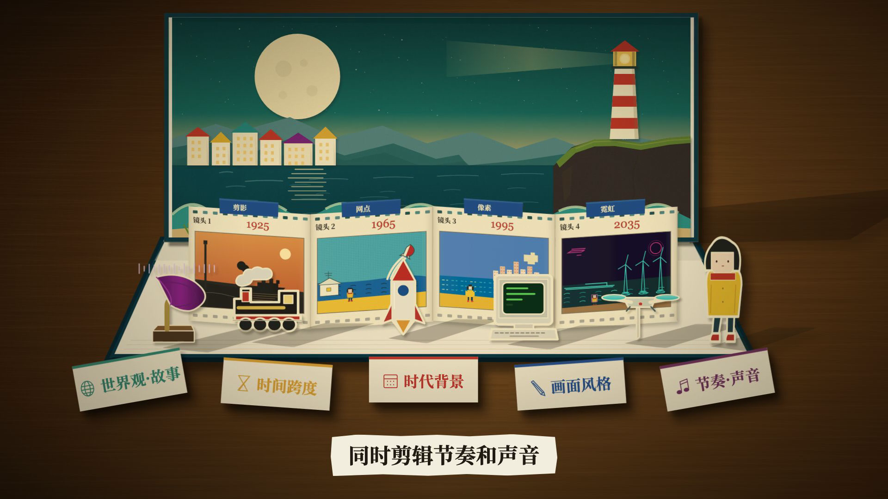

# 立体书：约束越多，作品越能脱颖而出

使用 Remotion 对参考动效进行程序化复刻。纸盒、木桌、立体书、海边场景、胶片折页和小道具由 React 组件、SVG 与 CSS 构建，并根据当前帧生成动画。



全部帧画面由 Remotion 组件生成，不是播放参考视频。字幕和动画按参考旁白的时点对齐。公开版本使用自行合成的纸张、机械音效与轻柔和声音轨 `public/audio/paper-score.m4a`，不包含参考视频的原始旁白或其他原始音频。

| 项目 | 参数 |
| --- | --- |
| Composition | `PopUpBook` |
| 分辨率 | 1920 × 1080 |
| 帧率 | 30 fps |
| 总帧数 | 1146 |
| 时长 | 38.2 秒 |
| Remotion / CLI | 4.0.533 |

## 安装与预览

在工程目录执行以下命令。依赖版本由 `package-lock.json` 固定。

```bash
npm ci
npm run dev
```

在 Remotion Studio 中选择 `PopUpBook`，可拖动时间轴检查任意一帧。

## 检查与渲染

```bash
# TypeScript 类型检查
npm run typecheck

# 渲染第 720 帧，即 24 秒处的静帧
npm run still -- --frame=720

# 渲染完整视频
npm run render
```

静帧输出至 `out/popup-book.png`，视频输出至 `out/popup-book.mp4`。首次使用 Remotion 渲染时，CLI 可能需要下载其使用的浏览器运行环境。

本次已通过 TypeScript 检查、完整 MP4 渲染、关键帧目视检查和整段音视频解码验证。实测视频流为 H.264、1920×1080、30fps、1146 帧、38.2 秒；音频为 48kHz 双声道 AAC。机器可读结果见 [validation.json](docs/validation.json)。

## 代码与素材

```text
src/
  index.ts           Remotion 注册入口
  Root.tsx           Composition 与视频参数
  PopUpBook.tsx      主时间轴、开合书、镜头、字幕与音轨
  OmniMachine.tsx    OMNI 纸盒与纸张
  Seaside.tsx        月亮、海面、山峦、房屋与灯塔
  StoryPieces.tsx    胶片折页、火车、火箭、电脑等纸质道具
public/
  audio/            自行合成的纸张与机械音效
  fonts/            中文衬线字体与 OFL 许可
  textures/         木纹与纸张颗粒 SVG
docs/
  reference-analysis.md  参考画面、节奏及完整字幕分析
```

音轨可用 Python 3 标准库脚本重新生成（转换为 AAC 需安装 ffmpeg）：

```bash
python3 scripts/generate-audio.py
ffmpeg -y -i out/paper-score.wav -c:a aac -b:a 160k public/audio/paper-score.m4a
```

调整时长、帧率和画布尺寸可修改 `src/Root.tsx` 中的 `VIDEO_CONFIG`；主要动画时刻和字幕时间位于 `src/PopUpBook.tsx`。

中文使用随工程提供的 `NotoSerifCJKsc-Bold.otf`。该字体按 SIL Open Font License 1.1 再发行，许可见 `public/fonts/OFL.txt`，上游为 [Noto CJK](https://github.com/notofonts/noto-cjk)。

## 复刻范围

本项目属于参考视频的程序化复刻，重建主要构图、纸艺元素、场景顺序、动作节奏和字幕同步，并非像素级一致。主观造型、纸张纹理、光照与镜头透视存在近似；原片中的真实材质与复杂三维细节通过 SVG 和 CSS 表现。公开版用合成音效替代原始旁白，字幕保留参考文案。

参考片段：[Motionface 动效片段](https://motionface.cc/?recording=ad1b3f0a-1770-4743-a28f-9a7ad9c378af)。详细观察见 [参考分析](docs/reference-analysis.md)。
